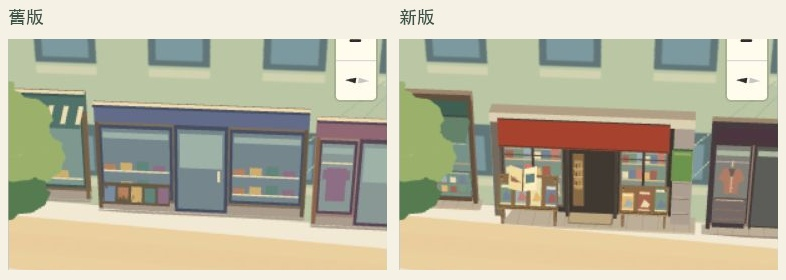
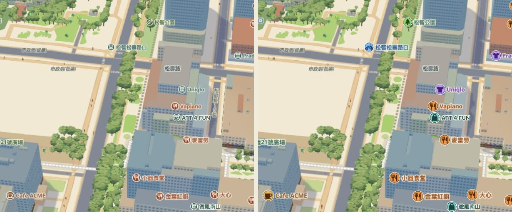

# 台北 Pocket City

同一個台北街區有兩個入口。「3D 街景」可以拖曳、旋轉和放大到復興南路的招牌。「Apple 地點」在 Apple 地圖上顯示 Pocket City 插畫，沿用 Apple 提供的興趣點與地點卡。這個原型沒有 Savvy 帳號資料。



## Savvy App 地點與貼文接入

[101 周邊的分類 pin 預覽](http://127.0.0.1:42418/index.html?view=121.5657,25.0348,17.65&bearing=-8)。城市、街區和街口依縮放層級顯示地點。下圖為同一鏡位，左為前版、右為本版。



- 首次執行下方的 `prepare_data.py` 後，透過 [loadCityPlaces](city-place-index.js) 取得 GeoJSON FeatureCollection。這個快照收錄台北 12 區共 39,664 筆。每筆以 `properties.placeId` 識別，Point 座標順序為經度、緯度。行政區和分類在 `district`、`category` 與 `categoryLabel`，部分地點沒有名稱。如果已有舊版 `data/`，可在本次提交的新工作目錄重新還原。
- App 接入時，請把已確認的 Savvy 分店識別碼和地圖的 `placeId` 建立對應，再帶入該分店的已審核貼文。開啟 pin、瀏覽公開來源或找到同名分店都不會建立使用者收藏。無法確認分店的貼文留待核對。
- [地點卡](place-callout.js) 與 [照片解析](place-photos.js) 是網頁原型的接入位置。目前只有三筆附來源的示範照片。接入貼文時，有可展示的原圖就顯示圖片及來源，只有原文連結就保留文字卡與連結。請用有圖、無圖、同名不同分店三種情境驗收。

## Mac 上看 Apple 地點

在 macOS 15 以上，安裝 Xcode 命令列工具後，從專案根目錄執行以下指令。開啟的視窗從大安區復興南路出發。拖曳可移到附近街口，點選地點標記可看 Apple 提供的詳細資訊。原生版先查詢目前視野內的地點。若附近查詢不提供結果，則查詢視野內的餐廳。可在下方輸入店名、書店或咖啡等類別。原生版直接使用系統 MapKit，無須設定網頁 token。地圖、地點與地點卡需要連線。

```sh
cd Prototypes/TaipeiPocketCity
python3 prepare_data.py
bash native/run.sh
```

## 在瀏覽器開啟 3D 街景

從專案根目錄執行。首次還原需要 Python 3.9 以上。圖資封裝檔約 242 MiB，另預留 650 MiB 還原空間。

```sh
cd Prototypes/TaipeiPocketCity
python3 prepare_data.py
python3 -m http.server 42418 --bind 127.0.0.1
```

- [復興南路書店](http://127.0.0.1:42418/index.html?street=fuxing)可從同一鏡位切換「舊版對照」或隱藏店名。點「看整排」拉遠。搜尋框能跳到其他行政區。
- [Apple 地點](http://127.0.0.1:42418/apple.html)使用 MapKit JS。請在此資料夾建立 Git 忽略的 `apple-config.js`，內容為 `export const token = "YOUR_PUBLIC_MAPKIT_JS_TOKEN";`。請使用允許實際預覽主機的瀏覽器 token。所有 Apple 私鑰都應存放在網頁服務目錄之外。兩種模式的底圖服務需要網路。[MapKit JS 文件](https://developer.apple.com/documentation/mapkitjs)
- Apple 地圖自行選取當前比例下顯示的地點。選取 Apple 地點只開地點資訊。Apple 地點與原型收錄的店家分別由 Apple 和公開圖資提供，兩份資料的收錄範圍可能不同。
- 原始的 [台北 101 收藏印章示範](../Taipei101PocketCity/README.md)可獨立執行。

## Apple 地圖與插畫的資料來源

Mac 版透過 MapKit 即時取得地點。Apple 提供的地點只顯示在 Apple 地圖上，不寫進插畫圖包或 Savvy 收藏。插畫幾何來自獨立公開圖資，兩種底圖都能使用這份插畫。保留 Apple 和供應商標示及 OpenStreetMap 署名。[Apple 地圖服務條款，附件 6](https://developer.apple.com/support/terms/apple-developer-program-license-agreement/) · [OSM 授權與署名](https://www.openstreetmap.org/copyright)

## 圖資與來源

台北 12 區按 170 公尺街廓整理。3D 版保留市府建物量體、24,072 筆可定位的來源店家和公共樹籍。7,906 筆可對上臨街外牆。復興南路示範街廓有 19 間店面。信義書局的紅招牌與騎樓參照紀錄照片，書架、入口深度及鄰店外觀為插畫重建。[信義書局紀錄](https://www.dream-land.com.tw/56%E4%BF%A1%E7%BE%A9%E6%9B%B8%E5%B1%80/)

- 道路、建物輪廓與地點採 © OpenStreetMap contributors。OSM 衍生資料以 ODbL 1.0 提供，原始出處與擷取版本隨資料附於 `data/city170/index.json`。地圖署名見圖面。[OpenStreetMap 授權](https://www.openstreetmap.org/copyright)
- 臺北市政府都市發展局提供 2025 年 LOD1 模型。市府商業處、衛生局、市場處、公園處與捷運工程局提供其他圖層，各來源列於圖面及資料摘要。[LOD1 服務](https://historygis.udd.gov.taipei/arcgis/rest/services/Hosted/LOD1_2025/SceneServer) · [都發局資料開放宣告](https://udd.gov.taipei/QA/article/ngork7d) · [公共樹籍](https://data.gov.tw/dataset/128274)
- 3D 街景使用 OpenFreeMap、OpenMapTiles、Mapzen 地形及 MapLibre GL JS。插畫參考 April Zhu 的 Pocket City 與 Pocket Nature。[Pocket City](https://april-zhu.com/pocketcity) · [Pocket Nature](https://april-zhu.com/pocketnature) · [Pocket City 授權](assets/Pocket-City-LICENSE.txt) · [MapLibre 授權](assets/MapLibre-LICENSE.txt)

`prepare_data.py` 會查核每包 SHA-256，還原完成才建立 `data/`。可用 `tools/bundle_data.py <準備好的圖資資料夾> <輸出資料夾>` 重新封裝。封裝與還原會保留每份資料解壓後的內容，gzip 壓縮位元組可能不同。`scripts/` 保留地圖資料與模型的製作工具，各自使用原始來源與額外的製圖相依套件。
