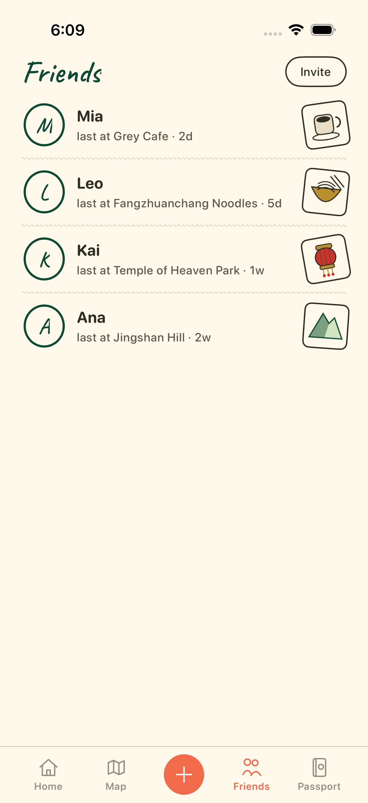
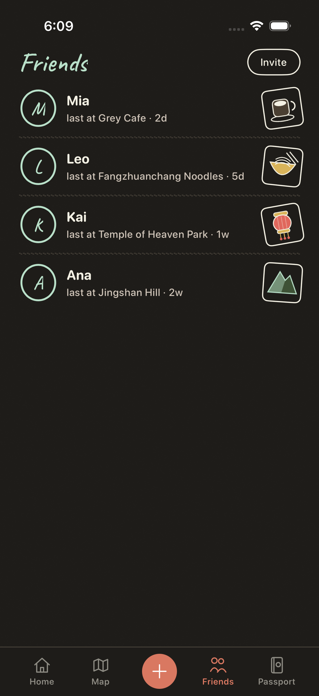
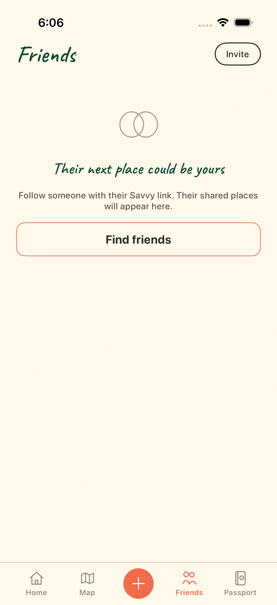
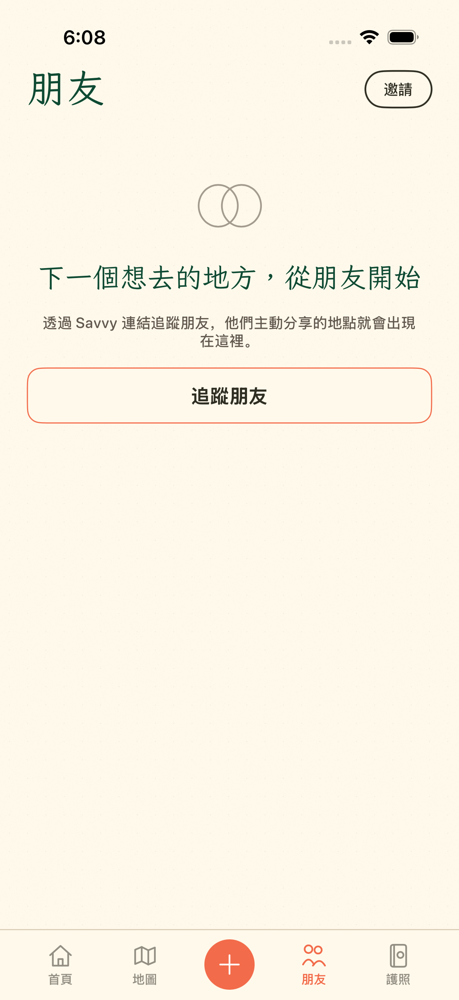
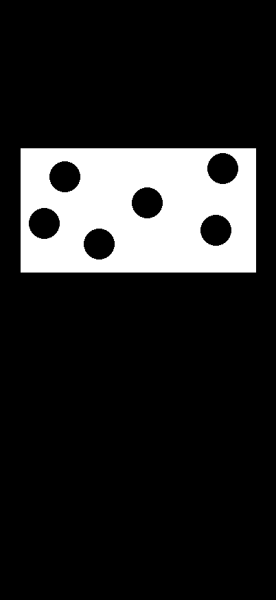

# PR 296 Friends evidence

HoP visual reference is Codex packet spec §7.4 and the Friends column of
the light/dark main mocks. DESIGN v2 `friends.png` is not adopted. Only
the 402×874 canvas and rough row spacing carry over. There is no 0.90
pixel gate against that raster.

## Section D gallery (simulator XCTAttachments)

Light and dark list, empty (en + zh-Hant). CI device is iPhone 16 Pro
(402×874), the packet canvas. 375pt / 430pt were not booted (would
need extra simulators and an `ios.yml` change HoP asked us to drop).

| Light list | Dark list |
| --- | --- |
|  |  |

| Empty (en) | Empty (zh-Hant) |
| --- | --- |
|  |  |

Parity mask (Home only; Friends has none):

## Provenance

These PNGs are real iOS Simulator XCTAttachments from the macOS `ios`
workflow, iPhone 16 Pro (402pt logical width), exported from
`xcresulttool` via `SAVE-First-Run/manifest.json`.

| File | Attachment name | Source |
| --- | --- | --- |
| `light-friends.png` | `light-friends` | run [39536918772](https://github.com/jh1nresh/SAV-E/actions/runs/39536918772), head `9fad61a` |
| `dark-friends.png` | `dark-friends` | same |
| `five-tab-friends.png` | `five-tab-friends` | same |
| `friends-empty.png` | `five-tab-friends-coming-soon` | same |
| `friends-empty-en.png` | `friends-coming-soon-en` | same |
| `friends-empty-zh-Hant.png` | `friends-coming-soon-zh-Hant` | same |
| `friends-en.png` | `friends-after-opening-en` | same |
| `friends-zh-Hant.png` | `friends-after-opening-zh-Hant` | same |
| `home-mask.png` | Home parity mask | `Prototypes/AtlasPostcard/Reference/ProductionTargets/home-mask.png` |

Friends has no ignore-mask. `home-mask.png` is the only production mask
(white = ignore) and is attached so the packet review can see the Home
gate is unchanged.

The Friends chrome in those rasters is the pre-P0 filled-sticker build.
The current head redraws stickers as 32pt ink outlines, thins the avatar
ring and Invite stroke, and drops the v2 0.90 gate. Fresh
`light-friends` / `dark-friends` / `friends-empty-*` /
`friends-dynamic-type-xxxl` / `friends-loading` / `friends-error`
attachments land on the next `ios` run under artifact
`save-atlas-parity-<sha>` → `SAVE-First-Run`.

CI does not boot 375pt or 430pt devices (one iPhone 16 Pro, 402pt). The
rail records `friends-window-width` on the Dynamic Type launch.

## Side-by-side vs packet §7.4 Friends column

Packet / main-mock column (from HoP + DESIGN 2026-10-21): people-first
list, Caveat/Iansui title, outline Invite, forest-ring avatars, last-at
rows, 32pt line-art stickers, no shared map, no animation (F-B11).

| Topic | Packet / mock | 9fad61a simulator rasters | Current head (code) |
| --- | --- | --- | --- |
| P0 stickers | 32pt outline line-art | Filled postage boxes (kraft/gold/red/green) | 32pt official outlines coffee / noodle / temple / lantern |
| P1 avatar ring | Packet forest ring | 2.4pt wobbly ink ring | 1.5pt circle stroke |
| P1 Invite | Outline chip | 1.5pt capsule | 1pt capsule, label = Invite / 邀請 |
| P1 Kai sticker | Official temple outline | Filled red lantern in a box | Official `.temple` (v2 lantern not adopted) |
| P1 tab bar | Shared Atlas root bar | Home / Map / + / Friends / Passport | Unchanged shared chrome (not a Friends-only file) |
| P2 background | Dotted paper | `SaveDottedBackground` (dots read faint at 1×) | Same |
| P2 fixture text | last at Place · 2d | Mia / Leo / Kai / Ana last-at copy | Same isolated `--uitest-friends-town` fixture |
| Empty (F-B2) | Empty + Find friends | `friends-empty*.png` | Same + zh-Hant |
| Loading / error (F-B3) | Must be shown | Not in 9fad61a set | New `friends-loading` / `friends-error` attachments |
| Animation (F-B11) | None | None | None (`SaveFriendsView` has no `withAnimation`) |
| 375 / 430 | Requested | Not captured | Not captured; CI is 402pt |

Invite / 邀請 opens Passport connections, Friends section:
`SaveFriendsView.onConnections` → `ContentView` sets
`requestsSocialConnections` and selects the Passport tab →
`ProfileView.requestsConnections` presents `PassportConnectionsView`.
